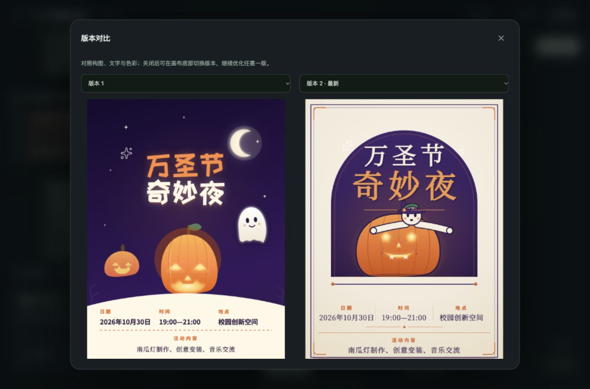

# PosterLab 现场展示逐步脚本

> 展示日期：2026 年 10 月 30 日。案例为演示用虚构活动，不是正式活动公告。
> 分工：你负责介绍、引导和解释；邀请的同学只负责点击和粘贴，不需要写代码或懂设计术语。
> 地址：<http://127.0.0.1:8787/>。需要在运行本地服务的这台电脑上操作。
> 本文中的按钮名称对应本次更新后的实际页面。生成内容和耗时会随模型响应变化，不能承诺现场与彩排完全相同。

## 1. 开场：先讲用户问题，再讲产品亮点（约 90 秒）

可以直接照着讲：

> 大家好，我们展示的是 PosterLab，一个面向非设计专业用户的 AI 海报创作工具。
>
> 做校园活动、社团招新或者小店宣传时，我们经常知道要宣传什么，却不知道怎样写设计需求。选模板容易撞风格，自己排版耗时间；即使 AI 生成了一张图，我们也很难说清楚哪里不好、应该怎么改。
>
> 所以，我们把产品设计成一个连续的创作过程：**说想法、整理需求、生成作品、看图评测、继续改版**。
>
> 第一，用户不用一次写出专业提示词。需求助手会帮助整理活动事实、受众和视觉方向；用户始终可以编辑和确认。
>
> 第二，海报不是在固定模板里替换文字。模型会编写完整 HTML、CSS 和矢量插画，使用真实中文字体，再渲染成可下载的图片。
>
> 第三，生成后的海报可以被评测。模型查看实际图片，结合排版参数，从六个维度给出分数、依据和修改建议。用户选自己认同的建议，再决定是精细调整、明显改版，还是换一个全新方案。
>
> 第四，每一版都保留，可以对比、继续修改和下载。我们希望把“不会写需求、不懂设计、说不清怎么改”这三个门槛一起降低。
>
> 接下来邀请一位同学上来。她不需要懂设计，我只给操作步骤，看看能不能完成一张校园活动海报。

### 讲创新时的准确说法

| 用户需求 | 产品做法 | 展示时可以强调 |
|---|---|---|
| 想法模糊，不知道怎么写提示词 | 需求助手、可编辑方案、六类场景表单 | 从普通人的表达开始，不要求先学会提示词工程 |
| 模板雷同，希望有个性 | 自主生成版式、SVG 插画、真实中文字体组合 | 风格只是参考，不锁死构图 |
| 觉得不好看，却说不出问题 | 六维评测、视觉依据、具体建议 | 把模糊的感觉变成可讨论的修改方向 |
| 改动不明显，或者改坏了 | 三种修改幅度、原图反馈、版本对比 | 可以大胆尝试，也能保留原版 |
| 要交付而不只是预览 | PNG、HTML 源文件与字体素材授权包 | 作品能够下载，也能查看生成依据 |

**创新定位**：这是产品工作流与交互整合的创新，不要说成“我们训练了一个新模型”或“行业首创”。也不要宣称 AI 评分是科学认证、商业转化预测或每次优化一定提分。

## 2. 展示前准备（主持人提前做，不占现场时间）

1. 使用这台已经安装好环境的电脑，提前打开 <http://127.0.0.1:8787/>。
2. 若网页打不开，双击项目目录的 `start_studio.command`；也可在项目目录运行 `./start_studio.command`。窗口提示输入密钥时，**在投屏前**输入 StepFun API key。输入隐藏且不自动保存到文件。不要把密钥写入讲稿或粘贴到网页聊天框。
3. 启动窗口不要关闭，电脑不要睡眠。若提示服务已运行，直接打开网页即可，不要重复启动多个进程。
4. 点左上角「打开对话列表」，再点侧栏底部「AI 已连接」，确认设计与评测模型为 `step-5-preview`。关闭弹窗和侧栏。
5. 浏览器窗口尽量宽一些，便于同时展示对话和 Canvas。窄窗口会显示「对话 / 画布」切换，这是正常的手机适配。
6. 点右上角「新对话」。本次不用品牌偏好；若此前启用了品牌信息，在「我的创作工具 → 品牌偏好」中关闭自动带入。
7. 把本文的三段输入文字预先准备好，方便同学复制。不要要求她现场手打长提示词。
8. 打开彩排的备用作品和流程截图；网络不稳时使用，明确告诉观众这是提前真实生成的彩排结果。
9. 费用与网络：需要 StepFun 账号有可用额度。本地预算预留不是平台真实余额；新模型费用以平台账单为准。不要在演示中展示密钥管理页面。

### 时间安排

- 主线：开场 → 需求助手 → 素材 → 生成 → 评测 → 明显改版 → 对比 → 下载。
- 生成和评测耗时不固定。建议预留 20 分钟以上；若只有 8 分钟，现场发起第一张生成，其余用彩排作品讲解，明确区分现场请求与提前结果。
- 「全新方案」「精确改文字」「场景模板」「收藏与品牌」放在加分环节，时间不够可跳过。

### 给同学的极简操作卡

1. 需求助手 → 粘贴简单需求 → AI 帮我完善提示词。
2. 在「已整理」框替换为确认稿。
3. 素材库 → 搜索星光 → 选象牙白 → 回到需求助手。
4. 按这个方案生成海报 → 等待画布出现图片。
5. 作品详情 → 看设计依据 → 关闭。
6. AI 评测海报 → 开始 AI 海报评测。
7. 取消默认勾选 → 选构图与留白、完成度与辨识度 → 明显改版 → 粘贴改版要求 → 按所选建议生成新版。
8. 版本对比 → 左 1 右 2 → 关闭 → 选择喜欢的版本。
9. 下载图片 → 作品详情 → 下载 HTML 源文件包。

主持人按下面详细步骤提供文字，同学只需要跟着这一张操作卡走。

## 3. 主线案例：为校园万圣节活动做海报

### 第一步：打开需求助手

**你对同学说**：

> 请先点输入框上方的「需求助手」。不用直接想一段很专业的提示词，只要把我们知道的信息说出来。

**同学操作**：

1. 点击「需求助手」。
2. 在「你想做什么？」输入框中全选原有内容，粘贴下面文字。
3. 点击「AI 帮我完善提示词」，只点一次。

```text
我们想为大学生办一场轻松有趣的万圣节活动，做一张能发到校园群的海报。标题：万圣节奇妙夜。日期：2026年10月30日。时间：19:00—21:00。地点：校园创新空间。活动内容：南瓜灯制作、创意变装、音乐交流。希望神秘但友好，有精致的南瓜和小幽灵原创插画，标题有个性，信息清楚，不要编造报名方式和价格。请帮我完善创作需求。
```

**等待时你讲**：

> 这一步是把用户的想法整理成设计委托，还没有生成海报。它会补充视觉表达的建议，但日期、地点等事实仍然由我们确认。

**成功标志**：下方出现「已整理 · 可以继续编辑」的文本框，以及「按这个方案生成海报」按钮。

### 第二步：确认并编辑完整需求

**你对同学说**：

> 请检查标题、日期、时间、地点和活动内容。AI 的创意可以参考，但不能替我们编造事实。为了便于今天现场对照，请把下方“已整理”的内容替换为这段确认稿。

**同学操作**：在「已整理 · 可以继续编辑」文本框中全选，粘贴以下完整内容。此时先不要点击生成。

```text
请生成一张用于校园群传播的万圣节活动海报。
标题：万圣节奇妙夜
日期：2026年10月30日
时间：19:00—21:00
地点：校园创新空间
活动内容：南瓜灯制作、创意变装、音乐交流
目标受众：大学生。
视觉要求：神秘但友好、有艺术感。用深紫、暖橙与奶油色构建有层次的画面，自主创作精致的南瓜和可爱小幽灵SVG插画，配合有性格的中文标题与清楚的信息排版。请自主决定最适合主题的构图、字体组合和插画细节，不要做成只有色块与文字的信息卡。已选星光素材自然融入。
画布：竖版1080×1440。
保留以上全部事实，不额外添加副标题、口号、主办方、费用、报名链接或联系方式。
```

**你补充说明**：

> 用户可以直接接受 AI 方案，也可以像现在这样编辑它。我们保留人工确认这一步，是为了让活动信息可靠、视觉方向可控。彩排时需求助手曾建议增加副标题，所以这里展示的是“确认后再生成”，不是盲目采纳。

### 第三步：选一项素材

**你对同学说**：

> 现在点弹窗顶部的「素材库」，给作品加一个真正参与生成的星光素材。

**同学操作**：

1. 点击弹窗顶部的「素材库」标签。
2. 在「搜索素材」中输入 `星光`。
3. 点击「星光 · 象牙白」的图片卡片，使它显示已选中。
4. 不要选背景图，也不要点「完成选择，返回对话」。直接点弹窗顶部「需求助手」回到刚才的方案。

**成功标志**：素材显示「已选 1 项」，回到需求助手后刚才编辑的方案仍在。

**你讲**：

> 素材是真实图片，会进入渲染结果和导出包。与此同时，模型还能自己绘制插画，不会因为素材库里没有南瓜就只能放一个通用图标。

### 第四步：生成第一张海报

**你对同学说**：

> 请点底部的「按这个方案生成海报」。接下来我们等画布出现作品，不需要再回到聊天框发送一次。

**同学操作**：点击「按这个方案生成海报」，只点一次。

**页面状态**：弹窗关闭，需求进入对话。先显示 AI 思考，随后进入设计、校验、渲染阶段。

**等待时你讲**：

> 后台正在根据这次需求编写版式和插画代码，然后用浏览器渲染成图片。它不是把字塞进一个固定模板。现在允许模型选择字体、重新组织构图和绘制矢量插画，所以需要一些生成时间。

**成功标志**：Canvas 中显示完整海报，顶部出现「下载图片」，底部出现「AI 评测海报」「优化这一版」。窄屏时先点「画布」。

**展示检查**：请同学读一下标题、日期、时间和地点；点击海报可放大，关闭弹窗返回。先确认文字正确，再讨论好不好看。

### 第五步：查看设计依据（约 30 秒）

**你对同学说**：

> 请点画布底部的「作品详情」，我们看看模型为什么这样设计。

**同学操作**：

1. 点击「作品详情」。
2. 看模型名称与「设计思路与实际变化」。
3. 展开「查看本次生成 / 修改要求」。
4. 可短暂展开「查看生成的 HTML」，证明作品有完整的源文件；不要逐行解释代码。
5. 点击右上角 × 关闭。

**你讲**：

> 用户不需要看代码才能使用。这里保留生成依据，是为了能追溯这张海报用了什么要求、由什么模型生成，也便于后续继续改。

### 第六步：启动六维评测

**你对同学说**：

> 现在假设我们觉得这张海报还可以更好，但说不清怎么改。请点「AI 评测海报」，再点「开始 AI 海报评测」。

**同学操作**：

1. 点击画布底部「AI 评测海报」。
2. 点击「开始 AI 海报评测」，只点一次。
3. 等待结果，弹窗可以保持打开。

**等待时你讲**：

> 这次评测会看实际生成图片，同时参考活动事实和实测排版信息。维度是视觉层级、文字可读性、构图与留白、配色与风格、信息传达、完成度与辨识度。综合分由程序按权重计算，不是随便写一个总分。

**成功标志**：出现综合分、六维雷达图、值得保留的优点，以及每个维度的「观察」「建议」。

**你讲**：

> 分数是辅助判断。更有价值的是它指向了什么具体问题，以及我们是否认可这些建议。我们不会为了追分自动覆盖原作。

### 第七步：按建议明显改版

**你对同学说**：

> 请先取消默认选择，然后选择「构图与留白」和「完成度与辨识度」。修改幅度选「明显改版」，再补充我们自己的意见。

**同学操作**：

1. 若右侧按钮显示「取消全选」，点一下清空当前选择；若显示「全选建议」，说明已经没有选择，不要点。
2. 分别勾选「构图与留白」「完成度与辨识度」。滚动弹窗即可找到。
3. 在「这次想改多少？」点击「明显改版」。它通常已默认选中。
4. 在「补充视觉要求（可选）」中粘贴下面文字。
5. 点击固定在底部的「按所选建议生成新版」，只点一次。

```text
请做一次能明显看出变化的艺术改版。保留全部活动文字和已选星光素材，但不要沿用原来的视觉骨架。改为奶油白纸张、深紫与暖橙的复古艺术海报，把南瓜与小幽灵重新设计成一组有故事感的主视觉，使用思源宋体与黑体形成更成熟的标题层级，重新安排信息区、留白和装饰。允许从头重写布局；不要只增加几颗星星或微调字号。请根据图片中的实际问题自主决定具体构图。
```

**等待时你讲**：

> 旧版的优化容易只改几个数值。这一版会把原图和原来的排版信息交给设计模型，并允许重构整体视觉。我们要求保留的是活动事实，不是旧布局。原图仍然保留，不满意可以回去。

**成功标志**：新作品出现在画布中，版本下拉框出现「版本 2 · 最新」。

### 第八步：比较两版，而不只盯着分数

**你对同学说**：

> 请点「版本对比」。左边选版本 1，右边选版本 2。你更喜欢哪一版？可以从主视觉、字体、配色或者信息清楚程度说一个理由。

**同学操作**：

1. 点击「版本对比」。
2. 在「左侧对比版本」选择版本 1；「右侧对比版本」选择版本 2。
3. 指出一处确实发生的变化，不要强行说新版一定更好。
4. 关闭对比弹窗。

**你讲**：

> 这就是我们希望的协作方式：AI 提供方案和修改依据，用户保留判断权。即使新版分数没有提高，用户也可以根据用途选择更合适的版本。

### 第九步：下载并完成交付

**你对同学说**：

> 请先在画布下方选中你喜欢的版本，再点顶部「下载图片」。这样下载的就是当前选中版本。

**同学操作**：

1. 在「画布版本」选择想下载的版本。
2. 点击画布顶部「下载图片」，保存 PNG。
3. 点击「作品详情」，滚动到底部，点击「下载 HTML 源文件包」。
4. 关闭弹窗。

**你讲**：

> PNG 可以直接用于传播；源码包包含版式、字体、素材和授权说明，便于继续编辑和交付。今天由一位不需要懂代码的同学，完成了从模糊需求到生成、评测、改版和下载的全过程。

## 4. 可选加分环节

主线之外的扩展操作不必全部现场执行；本次哪些已实测，以第 7 节为准。

### A. 重新评测新版

1. 画布选中版本 2，点「AI 评测海报」→「开始 AI 海报评测」。
2. 结果会展示与其来源版本的分数变化（前提是来源版本有评测）。
3. 只讲实测结果。分数可能下降，不要提前写死“提高了多少分”。
4. 在报告底部点「导出评测报告」，可下载 JSON；同一版本再次打开已有报告不会重新付费调用。

### B. 精确修改活动信息

在主聊天框输入下面一句并点击右下角「发送修改」：

```text
只把时间从19:00—21:00改为19:30—21:30，其他活动文字、配色、插画和布局都保持不变。这次做精细调整，不要重新设计。
```

等待新版本完成后核对时间。说明“明显改版”和“只改一个事实”是两种不同的用户意图，系统应该分别处理。

### C. 全新艺术方向

1. 点画布「优化这一版」。
2. 在「这次想改多少？」点「全新方案」。
3. 在「你的其他意见」填写：

```text
保留全部活动信息和已选素材，改为大胆的蓝橙撞色丝网印刷风格，重做主视觉与文字构图。不要沿用上一版的布局，给出一个完全不同的艺术方案。
```

4. 点「生成优化版本」。这会产生新调用和新版本；时间不足就只展示入口，不发起请求。

### D. 场景模板入口

点「新对话」→「场景模板」→「咖啡与市集」。说明：普通用户可以按表单填信息，不用写长提示词。示例字段为：标题「周末咖啡与旧书」、日期「2026年11月7日」、地点「校园草坪」、活动亮点「咖啡品鉴、旧书交换」。点击「生成这张海报」才会提交；时间不足可仅展示表单。

### E. 品牌偏好、收藏和备份

- 「我的创作工具」或侧栏「收藏与品牌工具」进入工具箱，可查看「品牌偏好」「我的收藏」。品牌名称、色系、语气、受众可作为后续创作偏好，保存在当前浏览器。
- 可收藏常用提示词供下次替换事实，减少重复输入。
- 「我的收藏」中可以导出对话备份 JSON；它包含对话与作品 ID，不包含海报文件。跨设备完整迁移还需要服务端作品目录。
- 现场只演示查看或导出即可，不要导入不明备份覆盖演示环境。

## 5. 常见现场情况与备用话术

| 情况 | 同学怎么做 | 主持人怎么讲 |
|---|---|---|
| 生成还在进行 | 不重复点按钮，不刷新提交 | “模型正在构建完整版式，我们趁这个时间看看用户为什么需要这个环节。” |
| 等待超出演示时间 | 保留请求，切到彩排对话或备用图片 | “网络和模型耗时会波动，下面用提前真实生成的同一案例展示后续流程。” |
| 出现失败提示 | 读具体原因；若显示「本地修复并出图（不调用模型）」可先点一次，无需再次付费生成。不要连点重试 | “系统不会拿固定模板冒充成功。原作和需求仍在，我们可以调整后重新提交。” |
| 分数没有提高 | 打开版本对比，看真实视觉变化 | “评分不是最终裁判，用户可以选更符合传播场景的版本。” |
| 找不到画布 | 窄屏点上方「画布」；宽屏点右上角画布入口 | “小屏将对话与画布分开，功能相同。” |
| 关掉了工具面板 | 从同一对话重新打开 | “草稿和修改选择会保留，不用重新填写。” |
| 网页打不开 | 主持人在投屏外检查启动窗口和本机端口 | 不让参与同学处理密钥或安装环境；使用备用流程 |

## 6. 收尾（约 30 秒）

> PosterLab 的重点，是把 AI 的生成能力接进一个普通人能完成的创作流程：需求不完整时有人帮你整理，作品生成后有人帮你指出问题，修改时有幅度选择，最终可以比较、保留和交付。
>
> 今天的版本是本机可运行产品。后续可以扩展团队品牌资产、多尺寸整套物料和协作批注；这些是下一步方向，不是今天已经实现的功能。

## 7. 彩排实测记录

彩排日期：2026 年 10 月 29 日。本机浏览器真实操作，使用 StepFun 真实 API，没有用固定模板或虚构响应代替结果。

| 环节 | 实测结果 |
|---|---|
| 需求助手 | 成功返回可编辑需求；曾建议副标题，人工替换为上面的确认稿 |
| 素材选择 | 成功选择「星光 · 象牙白」，切换工具标签后需求草稿保留 |
| 原创海报 | 成功，1080×1440；深紫夜景、暖橙南瓜、可爱幽灵；站酷快乐体标题 |
| 第一次评测 | 87.2 分；约 45 秒；六维图、观察和建议正常显示 |
| 明显改版 | 成功，约 3 分 21 秒；采用最新原生 HTML 输出链路 |
| 实际视觉变化 | 奶油白纸张、深紫拱框、思源宋体标题、重绘南瓜与戴帽幽灵、重新安排底部信息；像素变化约 78.9%，不是质量提升率 |
| 活动事实 | 两版标题、日期、时间、地点、活动内容一致；已通过程序核对，并人工查看成图 |
| 版本对比 | 成功；可切换左右版本，已调整预览高度，桌面能同时看完整海报 |
| 新版再评测 | 82.9 分，比原版低 4.3；约 59 秒；差值展示和 JSON 报告下载已实测 |
| 下载交付 | 新版 PNG、两版源码 ZIP 均已从网页下载；包内字体、素材、授权与真实提示词齐全 |
| 窄屏操作 | 390×844 检查通过；画布切换、修改幅度选择可见 |

**已知限制，主持人须知道**：新版评测里出现了把底部文字描述成“深紫底上的白字”的误读，实际是奶油底上的深紫字。不要把这条建议直接应用，也不要把评分下降解释成客观结论。现场可指出“AI 提供第二意见，最终要对照作品判断”，这是保留用户选择权的理由。

**彩排期间修复的故障**：首版因同一星光素材重复使用被旧校验拒绝，已放开合理重复并通过不调用模型的重新渲染恢复；第一次改版遇到长 HTML 的 JSON 转义损坏，已改为模型直接返回原生 HTML，随后新版成功。旧失败记录保留，没有删除或伪装成成功。首版总耗时包含调试，不作为正常生成速度承诺。

**可追溯记录**：

- 原版作品：`556313fbf265437aa0470355c3bac68f`，实际输入 992 / 输出 22065 tokens。
- 原版评测：`2259d66ae5fb43af8b94b6e4477037e7`。
- 成功改版：`6afde2056cf44e24b9dd6cbd16315edd`，实际输入 7704 / 输出 19749 tokens。
- 新版评测：`5bc0ee1afc2448cba98e2b86f67566ac`。
- 回归验证：82 项后端测试通过（不含旧版独立浏览器测试），17 项前端测试通过，生产构建通过；主线 UI 由本次浏览器实操验证。

本次额外实测了 A「重新评测新版」和报告导出。B「精确修改时间」、C「全新方案」、D/E 的完整提交链路未在本次再次执行，因此不把这些列为本次成功案例；可展示入口，主线不用依赖它们。

### 彩排资料与离线备用

输出目录为项目工作区下的 `outputs/demo-2026-10-30/`，包含：

- `PosterLab-明日展示完整流程.md`：这份完整讲稿。
- `离线备用展示.html`：双击可打开，图片已内嵌，无需服务器与网络；明确标注“提前真实彩排结果”。
- `海报-v1.png`、`海报-v2.png`：两张真实作品。
- `海报-v1-源码包.zip`、`海报-v2-源码包.zip`：完整字体、素材与 HTML 交付包。
- `01` 到 `10` 开头的截图：各环节证据。
- `generation-v1.json`、`generation-v2.json`、`evaluation-v1.json`、`evaluation-v2.json`：实测记录。

现场备用操作：直接双击 `离线备用展示.html` → 先看两版作品 → 往下滚动看需求、素材与评测截图。请明确说明是在展示提前彩排结果，不能把离线页说成正在调用 API。




## 8. 被问到技术原理时怎么回答

### “为什么以前优化变化小？这版改了什么？”

可以这样回答：

> 原来视觉指令和渲染规则更偏向保守排版，修改也容易被旧结构牵着走。这版同时调整了模型、提示词和渲染能力：设计与改版使用 Step 5 Preview 的高推理强度；原图直接回传；允许完整重写 HTML、绘制 SVG 插画和组合真实中文字体；“全新方案”甚至不再把旧 HTML 交给模型。改变不只来自换模型。

### “所谓不限制模型，是否完全没有要求？”

> 我们移除了固定版式、强制配色、只做小幅修改等创意限制。仍保留准确事实、文字可读、内容不越界和禁止执行脚本等交付要求。输出预算提高到该模型支持的 65536 tokens，而不是为了节省输出把设计截短。模型仍可能失败，系统会明确显示，不能保证每次生成都是最佳作品。

### “具体优化提示词是什么？”

默认“明显改版”的核心策略是：

```text
明显改版：根据需求重新作出设计决策，允许重写整个HTML、调整构图、字体组合、主视觉、色彩、信息组织。旧图不是必须保留的模板。用清楚可见且有目的的设计变化解决问题，不以多加几个装饰或微调几个数值代替改版。
```

完整请求还包含：用户的修改意见、必须保留的活动事实、所选评测建议、原海报图片、旧 HTML（全新方案除外）、实际文字尺寸与位置，以及素材清单。完整系统提示词和用户输入可在下载源码包的 `design-request.json` 中查看；密钥不在包里。

### “哪些地方真的调用了 API？”

| 环节 | API/模型 | 本地处理 |
|---|---|---|
| 需求助手、对话意图整理 | StepFun `step-3.5-flash` | 展示可编辑需求、组织事实 |
| 新海报与修改 | StepFun `step-5-preview`，高推理强度 | HTML 校验、浏览器渲染、PNG 保存、版本记录 |
| 六维评测 | StepFun `step-5-preview`，多模态看图 | 按公开权重计算总分、雷达图和版本差异展示 |
| 选素材、对比、下载、重新渲染已有输出 | 不调用外部模型 | 读取本地资源与已有作品 |

当前是本机可运行版本。账号体系、多人协作、线上计费和云部署尚未完成，展示时不要把这些未来能力说成已上线。


## 9. 新增：自由选择模型（展示可选，约 30 秒）

1. 关闭工具弹窗，点击聊天输入框下方「创作偏好」。
2. 在「选择你的 AI 搭档」中查看三个下拉框：需求助手与对话、海报生成与修改、海报视觉评测。
3. 推荐本次主线使用：需求助手 `Step 3.5 Flash`；生成与修改 `Step 5 Preview`；评测 `Step 5 Preview`。也可以保留对应服务默认。
4. 点击「完成」，再按前面的主线操作。选择在刷新后保留，从下一次请求生效。
5. 主持人说明：“用户可以按用途选择模型；看图评测只提供支持图像理解的模型。切换评测模型会产生独立报告，不能把换模型产生的分差当作作品质量变化。”

注意：本次此前的万圣节彩排使用 Step 5 Preview 设计与评测。新增模型选择功能通过请求路由、能力校验、模型缓存隔离测试；已在网页选择 Step 3.7 Flash 并完成一次真实 API 问答，刷新保留选择、切换评测模型读取独立结果也已验证；不声称三个模型都已跑过该完整彩排。切换模型可能改变风格、等待时间和实际费用。

## 生成交付修复更新

生成期间若出现「正在自动修复设计」，请等待，系统最多追加两轮模型纠错，不要连续点击。明确的资源/字段问题先本地免费修复。若最终仍失败，可先点「本地修复并出图（不调用模型）」；完整代码缺失或需要新方案时点「按原需求重新生成（调用模型）」，无需重输需求。生成与每轮纠错均消耗相应模型用量；网络超时不会自动重发。只有完成 PNG 校验的作品才提供下载。
